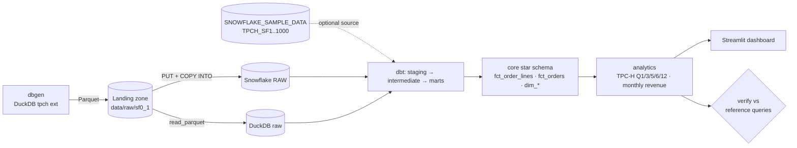

# TPC-H Data Engineering Pipeline

An end-to-end, warehouse-agnostic ELT project on the [TPC-H](https://www.tpc.org/tpch/) benchmark
dataset: generate source data, land it as Parquet, load it into **Snowflake** (or local **DuckDB**),
model it with **dbt** into a tested star schema, reconcile the results against the official TPC-H
reference queries, and explore it in a **Streamlit** dashboard.



## What it demonstrates

| Concern | How |
|---|---|
| Ingestion | Parquet landing zone with a manifest; Snowflake internal stage, `PUT`, typed DDL, `COPY INTO ... MATCH_BY_COLUMN_NAME`; row-count reconciliation and a `_load_audit` table |
| Modelling | dbt layers: `staging` (rename/cast, views) → `intermediate` (joins, revenue/margin measures) → `marts` (star schema tables) → `analytics` (business questions) |
| Star schema | `fct_order_lines` (grain: order line, **incremental**, clustered by `order_date` on Snowflake), `fct_orders`, `dim_customer`, `dim_supplier`, `dim_part`, `dim_date` |
| Portability | Same dbt project runs on Snowflake and DuckDB; `date_spine` is an `adapter.dispatch` macro, date math uses dbt cross-database macros |
| Data quality | ~60 dbt tests: keys, referential integrity, accepted values, custom generic tests (`column_between`, `min_row_count`), singular tests (order totals reconcile to lines, date ordering, no rows lost between layers) |
| Correctness | `pipeline.py verify` reads the TPC-H Q1, Q3, Q5, Q6, Q12 answers from the star schema (in DuckDB or Snowflake) and compares them to the official reference queries run by DuckDB on the raw data |
| Orchestration | `pipeline.py` runs generate → load → transform → verify as one idempotent command; GitHub Actions runs the whole pipeline on every push |
| Benchmarking | `pipeline.py bench` times the 22 standard TPC-H queries |

## Project layout

```
ingestion/          generate.py (dbgen → Parquet), load_duckdb.py, load_snowflake.py, config.py
tpch_dbt/           dbt project (profiles.yml reads credentials from env vars)
  models/staging/       stg_tpch__* + sources and tests
  models/intermediate/  int_order_lines__enriched, int_geography
  models/marts/core/    fct_* and dim_* (star schema)
  models/marts/analytics/ tpch_q01..q12, agg_revenue_monthly
  macros/               date_spine (dispatched), generic tests, schema naming
  tests/                singular data tests
dashboard/app.py    Streamlit dashboard
pipeline.py         orchestrator CLI
.github/workflows/  CI: full pipeline on DuckDB at SF 0.01
```

## Setup

Requires Python 3.11+. Verified on Windows 11 with Python 3.14.2, duckdb 2.0.0, dbt-core 1.12.7,
dbt-duckdb, dbt-snowflake, streamlit 1.67.

```powershell
python -m venv .venv
.\.venv\Scripts\Activate.ps1
pip install -r requirements.txt
```

### 1. Run locally on DuckDB (no account needed)

```powershell
python pipeline.py run --target duckdb --sf 0.1
streamlit run dashboard/app.py
```

Expected result at SF 0.1 (about 12 s end to end; the first run also downloads DuckDB's `tpch` extension):

```
[generate]   lineitem       600,572 rows
...
Done. PASS=90 WARN=0 ERROR=0 SKIP=0 NO-OP=0 REUSED=0 TOTAL=90
[verify] Q1  tpch_q01_pricing_summary           rows=4   OK
[verify] Q3  tpch_q03_shipping_priority         rows=10  OK
[verify] Q5  tpch_q05_local_supplier_volume     rows=5   OK
[verify] Q6  tpch_q06_forecast_revenue_change   rows=1   OK
[verify] Q12 tpch_q12_shipping_modes            rows=2   OK
```

`python pipeline.py bench --sf 0.1` runs all 22 TPC-H queries in about 0.3 s total
(geometric mean ~12 ms per query) on a laptop.

### 2. Run on Snowflake

1. `copy .env.example .env` and fill in your account, user, role, warehouse and database.
   Key-pair auth (`SNOWFLAKE_PRIVATE_KEY_PATH`) is recommended; password and
   `externalbrowser` SSO also work. `.env` is git-ignored.
2. Your role needs `CREATE SCHEMA` on the database (and `CREATE DATABASE` if it does not exist yet)
   plus `USAGE` on the warehouse.
3. Run:

```powershell
python pipeline.py run --target snowflake --sf 0.1        # land, load, build, test
streamlit run dashboard/app.py -- --snowflake
```

Objects created: `<DB>.RAW` (raw tables, stage `tpch_landing`, `_load_audit`), and
`STAGING`, `INTERMEDIATE`, `MARTS`, `ANALYTICS` schemas from dbt.

**Skip ingestion entirely** by reading Snowflake's built-in TPC-H share (SF 1, 10, 100 or 1000):

```powershell
python pipeline.py run --target snowflake --source sample --sf 1
```

### Individual steps

```powershell
python pipeline.py generate --sf 0.1 [--force]
python pipeline.py load      --target snowflake --sf 0.1
python pipeline.py transform --target snowflake [--select marts] [--full-refresh]
python pipeline.py verify    --target duckdb
python pipeline.py bench     --sf 0.1 --runs 3
```

## Scale factors

| SF | lineitem rows | Parquet size |
|---|---|---|
| 0.01 | ~60K | ~3 MB |
| 0.1 (default) | ~600K | ~30 MB |
| 1 | ~6M | ~300 MB |
| 10 | ~60M | ~3 GB |

## Notes

- `fct_order_lines` is incremental: re-runs merge only orders from the latest `order_date` minus a
  7-day look-back. Use `--full-refresh` after regenerating data at a different scale factor.
- Dimension keys are the TPC-H natural keys (stable integers), so no surrogate-key hashing is needed.
- `pipeline.py` runs dbt as a subprocess (the `dbt` CLI from the active venv). dbt-duckdb holds the
  database file open for the life of its process, so running it in-process would block `verify`.
- `assert_order_total_reconciles_with_lines` allows 2 cents per line: dbgen rounds each line to
  cents twice (after discount, after tax), so `o_totalprice` drifts slightly from the exact sum.
- On Snowflake, `verify` computes the reference answers with DuckDB over the same Parquet files
  that were loaded, so both warehouses are checked against one independent reference. It is skipped
  for `--source sample` (no local copy of the sample share).
- Verified on a live Snowflake account at SF 0.1: load (8 tables, row counts reconciled), dbt build
  90/90, verify 5/5, an incremental re-run that merged 1,999 lines, and the dashboard in `--snowflake` mode, all
  matching the DuckDB results. CI covers the DuckDB path only.
